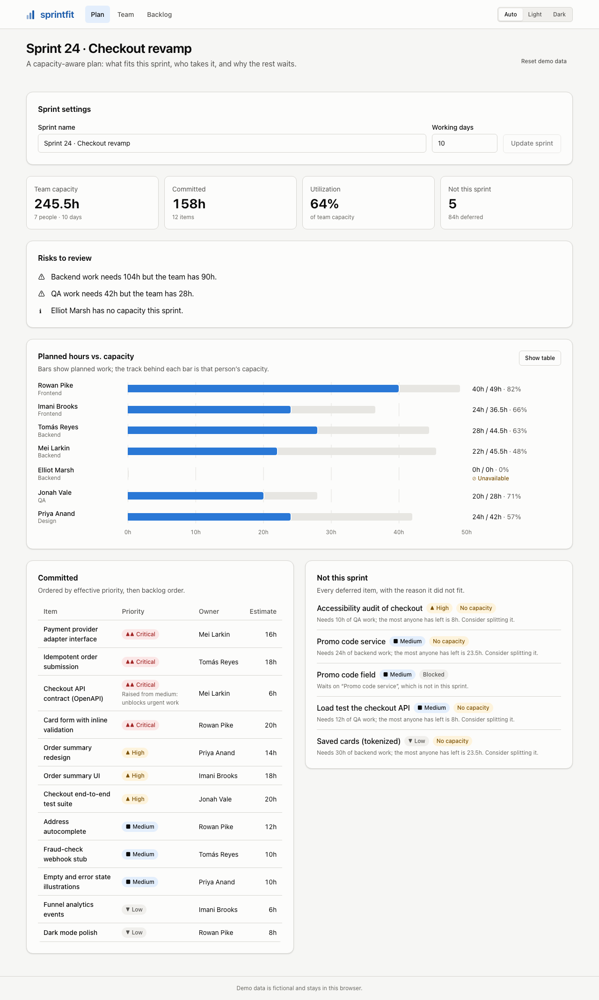
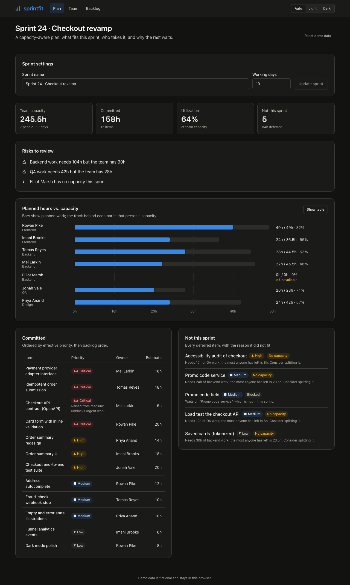
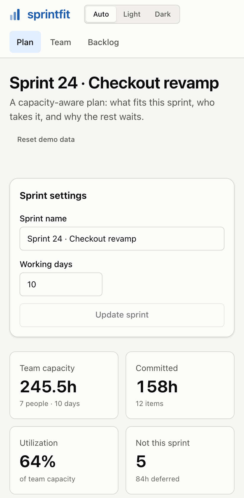
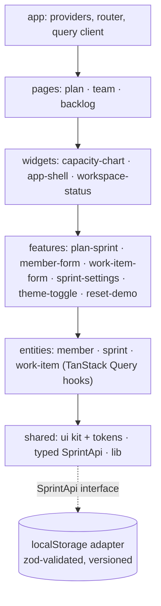

# sprintfit

**Capacity-aware sprint planning: see what actually fits this sprint, who takes it, and why the rest waits.**

[](https://github.com/Mbarney928/sprintfit/actions/workflows/ci.yml)
[](https://mbarney928.github.io/sprintfit/)
[](LICENSE)


**Live demo:** https://mbarney928.github.io/sprintfit/ · **Storybook:** https://mbarney928.github.io/sprintfit/storybook/



<p align="center">
  
  
</p>

## The business problem

Sprint planning usually means summing story points against a velocity number that ignores who is on
holiday, who is on call and who can actually do the work. Teams overcommit, a QA bottleneck shows up on
day 8, and the urgent item turns out to be blocked by a "low priority" ticket nobody picked up.

sprintfit is for **engineering managers and tech leads** running planning meetings. It turns the team's
real availability and the backlog's dependencies into a plan that fits, and it explains every item it
leaves out. The metric it improves is **sprint commitment reliability**: the share of committed work
that actually ships.

## Features

- **Real capacity per person.** Working days − PTO − half of on-call days, × hours per day × focus factor,
  with a live preview while editing.
- **Dependency-aware planning.**
  - Topological ordering with cycle detection.
  - Blockers _inherit_ the priority of the urgent work waiting on them.
- **Skill matching.** Work goes only to people with the right skill, balanced worst-fit so nobody is
  overloaded while a teammate idles.
- **Every deferral explained:**
  - no capacity, with a split suggestion when hours are fragmented
  - skill gap
  - blocked by an item that didn't fit
  - dependency cycle
- **Risks to review:**
  - a critical item spilled
  - skill demand above supply
  - people at ≥ 90% with no slack
  - people with no capacity
- **Accessible capacity chart.**
  - Keyboard-operable bars, tooltips and direct labels.
  - A table view of the same data.
  - Validated colors in light and dark mode.
- **Team and backlog management.**
  - Validated forms with focus moved to the first error.
  - Two-step confirmation for destructive actions.
- **Dark mode** (auto / light / dark, remembered). Responsive from phone to desktop.
- **Persists in the browser** with versioned, migrated storage and recovery from corrupt data.

## Architecture



The code follows **Feature-Sliced Design**. Layers import only downward, and only through a slice's
public `index.ts`. ESLint (`eslint-plugin-boundaries`) enforces this, so a violation fails CI.

Key decisions and trade-offs are recorded as ADRs:

| ADR                                                               | Decision                                                                                        |
| ----------------------------------------------------------------- | ----------------------------------------------------------------------------------------------- |
| [0001](docs/adr/0001-feature-sliced-architecture.md)              | Feature-sliced layers with lint-enforced import boundaries                                      |
| [0002](docs/adr/0002-api-interface-with-local-adapter.md)         | A typed `SprintApi` interface with a localStorage adapter, so a real backend is a one-file swap |
| [0003](docs/adr/0003-accessible-chart-without-a-chart-library.md) | A hand-built HTML chart instead of a 50 KB+ chart library, for accessibility and size           |

**The planner** (`src/features/plan-sprint/model/plan.ts`) is a pure function:

1. Compute each member's capacity.
2. Topologically sort the backlog (Kahn's algorithm). Cycles are reported, not looped on.
3. Propagate effective priority from dependents to their blockers.
4. Walk items in priority order, with backlog order as the tie-break.
5. Assign each item to the same-skill member with the most free hours.
6. Spill whatever cannot be placed, with a reason.

Dependents of spilled items are blocked transitively.

## Tech stack

| Choice                                                                                       | Why                                                                                                  |
| -------------------------------------------------------------------------------------------- | ---------------------------------------------------------------------------------------------------- |
| **React 19 + TypeScript (strict, `exactOptionalPropertyTypes`, `noUncheckedIndexedAccess`)** | Typed props and data end to end                                                                      |
| **Vite 8**                                                                                   | Fast builds, lazy route chunks, manual vendor chunking                                               |
| **TanStack Query**                                                                           | Server-state cache behind the API interface. Mutations invalidate, with no hand-rolled loading flags |
| **Zustand**                                                                                  | Client-only state (theme preference), persisted                                                      |
| **React Router (hash router, lazy routes)**                                                  | Works on static GitHub Pages hosting, with code-split pages                                          |
| **zod**                                                                                      | One schema validates forms, API inputs and stored data                                               |
| **CSS Modules + design tokens + cva**                                                        | Scoped styles, light/dark tokens as CSS variables, typed component variants                          |
| **Vitest + Testing Library + axe-core**                                                      | Component and integration tests with accessibility assertions                                        |
| **Playwright + @axe-core/playwright**                                                        | Real-browser flows on desktop and mobile, with WCAG scans including color contrast                   |
| **Storybook 10 + a11y addon**                                                                | A component catalog covering every state                                                             |
| **Lighthouse CI + a gzip bundle budget**                                                     | Performance regressions fail CI                                                                      |

## Quick start

Requires Node 22+.

```bash
git clone https://github.com/Mbarney928/sprintfit.git
cd sprintfit
cp .env.example .env    # optional: no secrets needed; only BASE_PATH for sub-path hosting
npm ci
npm run dev             # http://localhost:5173
```

| Command                                     | What it does                                                                                      |
| ------------------------------------------- | ------------------------------------------------------------------------------------------------- |
| `npm run storybook`                         | Component catalog at http://localhost:6006                                                        |
| `npm run build && npm run preview`          | Production build at http://localhost:4173                                                         |
| `npm run test` / `npm run coverage`         | Unit, component and integration tests                                                             |
| `npm run e2e`                               | Builds the app and Storybook previews, then runs Playwright (run `npm run build-storybook` first) |
| `npm run size:check` / `npm run lighthouse` | Performance budgets (after `npm run build`)                                                       |

## Usage

The demo opens on a fictional seven-person team planning "Sprint 24 · Checkout revamp". Try:

1. **Backlog → Add item.** Add a critical item that depends on _Promo code field_. Its blockers inherit
   critical priority and get pulled into the sprint.
2. **Team → Edit.** Give someone 5 PTO days and watch the plan rebalance.
3. **Plan → Working days.** Shorten the sprint and see what spills, and why.

Components are reusable on their own:

```tsx
import { Button, Card, TextField } from '@/shared/ui';

<Card
  title="Sprint settings"
  actions={
    <Button size="sm" variant="secondary">
      Reset
    </Button>
  }
>
  <TextField label="Working days" type="number" error={errors.workingDays} />
</Card>;
```

Adding a real backend means implementing the `SprintApi` interface and passing it to `<ApiProvider>`:

```ts
export interface SprintApi {
  getWorkspace(): Promise<Workspace>;
  saveMember(input: MemberInput, id?: string): Promise<Member>;
  deleteMember(id: string): Promise<void>;
  saveItem(input: WorkItemInput, id?: string): Promise<WorkItem>;
  deleteItem(id: string): Promise<void>;
  updateSprint(input: Sprint): Promise<Sprint>;
  resetDemo(): Promise<Workspace>;
}
```

## Testing & quality

**Unit, component and integration tests:** 63 tests (Vitest).

- Planner rules, storage migrations, API validation and UI components.
- Full-app integration tests that drive every page through the real router, API and storage, with an axe
  check on each page.

**Coverage:** 97.9% lines · 97.0% statements · 94.6% functions · 88.4% branches. CI enforces thresholds
of 85/85/85/80.

**End-to-end:** 106 Playwright tests.

- User flows on desktop Chrome and a Pixel 7 viewport: add an item and see it planned, reload
  persistence, keyboard use of the chart, theme persistence, and the skip link.
- WCAG 2.2 AA axe scans of every page in light and dark mode.
- An axe scan of every Storybook story in both themes.

**Lighthouse** (desktop, median of 3 runs):

| Performance | Accessibility | Best practices | SEO |
| ----------- | ------------- | -------------- | --- |
| 100         | 100           | 96             | 100 |

LCP 0.5 s · TBT 0 ms · CLS 0.05.

**Bundle:** 134 KB gzip of initial JS (budget 160 KB). Each lazy page chunk is ≤ 4.5 KB (budget 25 KB).

**Static checks:**

- ESLint with `typescript-eslint` strict-type-checked, `jsx-a11y` strict, React hooks rules and import
  boundaries. Zero warnings allowed.
- Prettier.

Every push runs all of the above in CI.

## Security

- **No secrets by design.** The app is static and needs no keys, accounts or backend.
- **Synthetic data only.** The team and backlog are fictional, and user edits stay in the visitor's browser.
- **Secret scanning.**
  - gitleaks runs as a pre-commit hook and as a CI job over full git history.
  - GitHub secret scanning and push protection are enabled.
- **Dependency audits.**
  - `npm audit` runs in CI: zero production advisories allowed, and no high or critical in dev tooling.
  - A transitive `basic-ftp` advisory is pinned to the patched version through `overrides`.
  - Dependabot runs for npm and GitHub Actions.
- **Hardened CI.**
  - Read-only default token, with `pages`/`id-token` write only on the deploy job.
  - Actions pinned to full commit SHAs.
  - `persist-credentials: false`, `pull_request` only, and no repository secrets.
- **App hardening.**
  - Strict CSP (`script-src 'self'`).
  - `dangerouslySetInnerHTML` banned by lint.
  - All input validated with zod at the form and again at the API boundary.
  - Errors never surface internal details.

See [SECURITY.md](SECURITY.md) for reporting.

## Roadmap

- **Carry-over and velocity history:** compare planned against completed per sprint to calibrate focus factors.
- **Multi-skill members** with a primary/secondary skill and a preference weight in assignment.
- **Item splitting in one click** from the "Consider splitting it" suggestion.
- **A real backend adapter** (Fastify + Postgres) implementing `SprintApi`, with optimistic updates.
- **Shareable read-only plan links** for stakeholders.

## License

Released under the [MIT License](LICENSE).
